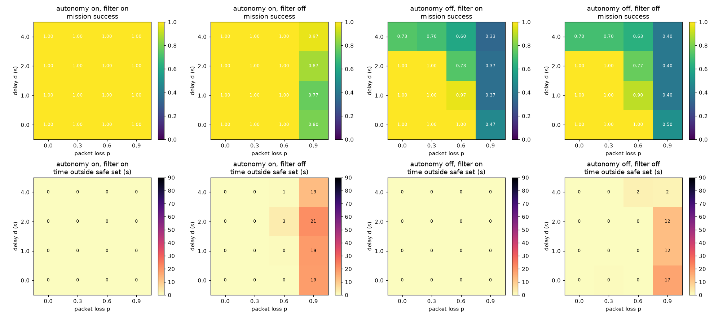

# Defining the equation of a military HQ via control systems

Can a central HQ, connected to a fleet of autonomous nodes (drones, ground robots), be written down as one control system? This repo models it as a **cascaded (hierarchical) feedback system** with three nested loops, each slower and smarter than the one inside it:

| Loop | Runs on | Rate | Controller |
|------|---------|------|------------|
| Inner | Vehicle autopilot (PX4 / ArduPilot) | ~400 Hz | PID on the vehicle dynamics, no model |
| Middle | Node agent | ~10 Hz | Small onboard model + safety filter picks the next waypoint |
| Outer | HQ | ~1 Hz | Planner model reallocates tasks over a lossy, delayed radio link |

## Scope

- **Non-kinetic.** The reference mission is search-and-rescue / mapping in a disaster zone with simulated jamming. No targeting or weapon-engagement logic.
- **Human judgment stays in the loop.** HQ intents pass an operator approval screen (in line with DoDD 3000.09).
- **Security is the research angle:** spoofed HQ orders, a captured node, prompt injection through sensor data, model theft from a downed vehicle.

## Contents

| File | What it holds |
|------|---------------|
| [docs/system_equations.md](docs/system_equations.md) | The full model: plant, three loops, closed-loop form, linearisation |
| [docs/architecture.md](docs/architecture.md) | HQ / node design, control principles, MVP and the planned experiment |

| [sim/model.py](sim/model.py) | The equations in Python: plant, autopilot, node agent, safety filter, HQ, lossy link, spoofing |
| [sim/step_response.py](sim/step_response.py) | Inner loop only: damping, altitude/tilt, wind offset with PD vs PID |
| [sim/sweep.py](sim/sweep.py) | Full system: sweeps delay `d` × loss `p` for autonomy on/off × safety filter on/off |

## Run it

```bash
uv run python sim/step_response.py   # -> figures/step_response.png
uv run python sim/sweep.py           # -> figures/sweep.png, results/sweep.csv
```

The node and HQ models are rule-based stand-ins for now, so the control structure can be checked before an LLM is plugged in.

## First results

- **Inner loop matches the math:** constant wind leaves the predicted offset `w/(m·Kpx)` = 0.250 m (simulated 0.249 m); an integral term removes it.
- **Local autonomy makes the mission robust to the link:** with autonomy, all survey points are visited at every tested delay and loss; without it, success drops to ~0.33–0.50 at 90 % loss and to ~0.70 at 4 s delay.
- **The safety filter keeps the vehicle in the safe set:** 0 s outside the geofence with the filter, up to ~21 s without it. Spoofed orders hurt most when the link is bad, because legitimate HQ messages no longer overwrite them.


