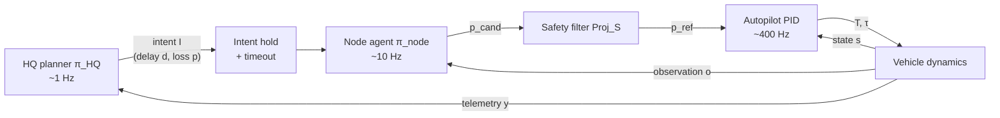

# Architecture

An HQ directly connected to many nodes. Every node runs its own model; the HQ runs a larger planner model. Drones, ground robots and (later) humanoids all report to the HQ.

## Design notes

- **Models do tasking, not flying.** A standard autopilot (PX4 / ArduPilot) handles flight; the model decides what to do next.
- **Security is the real product:** spoofed HQ orders, a captured node, prompt injection through sensor data, model theft from a downed drone.
- **Skip humanoids in v1.** Simulated ground robots cover the same problem.
- **Human judgment stays in the loop.** US policy (DoDD 3000.09) requires autonomous systems to let commanders exercise appropriate human judgment over the use of force; commercial systems such as Anduril Lattice also keep a human supervising.

## Cascaded control view

- **Inner (autopilot):** PID / position control on the vehicle dynamics. Deterministic and fast, so no model goes here.
- **Middle (node agent):** the small onboard model picks the next waypoint or task from camera and local map, holding the last HQ intent.
- **Outer (HQ):** the planner reallocates tasks across the fleet from fused telemetry. It is the only loop that crosses the radio.

## Control principles

- **Timescale separation:** each loop runs ~5–10× slower than the one inside it, so each can be designed and tested on its own.
- **Networked control:** the outer loop has delay `d` and packet loss `p`. When the link drops, the node holds the last intent, then falls back to a safe default (loiter, return to base) after a timeout.
- **Safety filter (Simplex architecture):** a small, verifiable rule layer between node agent and autopilot. If the model proposes something unsafe (outside the geofence, low battery), the simple controller overrides it. This is where LLM-security work plugs in.
- **Adversarial disturbances:** jamming hits the link; spoofing corrupts the reference or the feedback. Signed commands plus a residual check (does the telemetry match what the model predicted?) catch most of it.

## Sample project (MVP)

| Part | Choice |
|------|--------|
| Simulation | PX4 SITL + Gazebo, ~5 drones + 2 ground robots |
| Mission | Search-and-rescue / mapping in a disaster zone with simulated jamming |
| HQ | Planner LLM, shared map, operator approval screen |
| Nodes | Rust runtime, small Ollama model, rule-based safety guard |
| Comms | A2A over Zenoh or ROS 2, signed messages, mesh fallback |
| Red-team harness | Inject spoofed orders, a compromised node, link loss |

## Planned experiment

Sweep link delay `d` and packet loss `p`. Compare four arms: with / without local autonomy × with / without the safety filter.

| Metric | Meaning |
|--------|---------|
| Mission success | Fraction of the area mapped / targets found within the time limit |
| Malicious commands rejected | % of injected spoofed orders that never reach the autopilot |
| False rejections | % of legitimate HQ intents blocked by the filter or signature check |

The equations behind each block are in [system_equations.md](system_equations.md).
